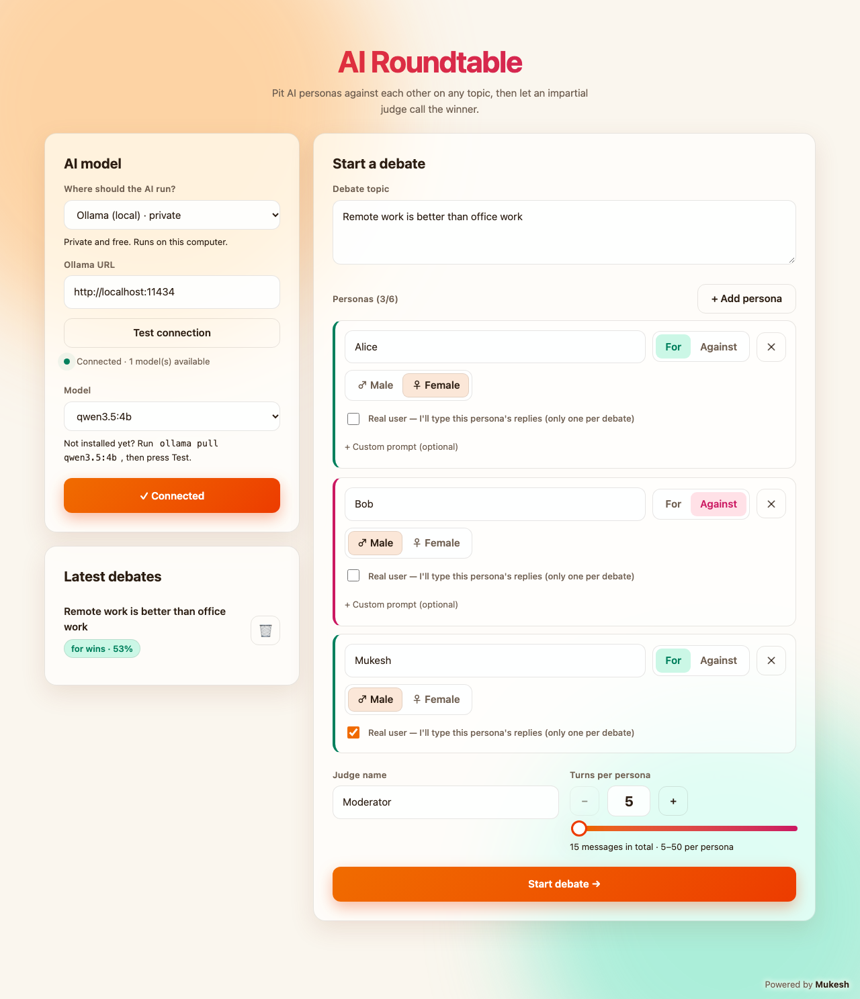
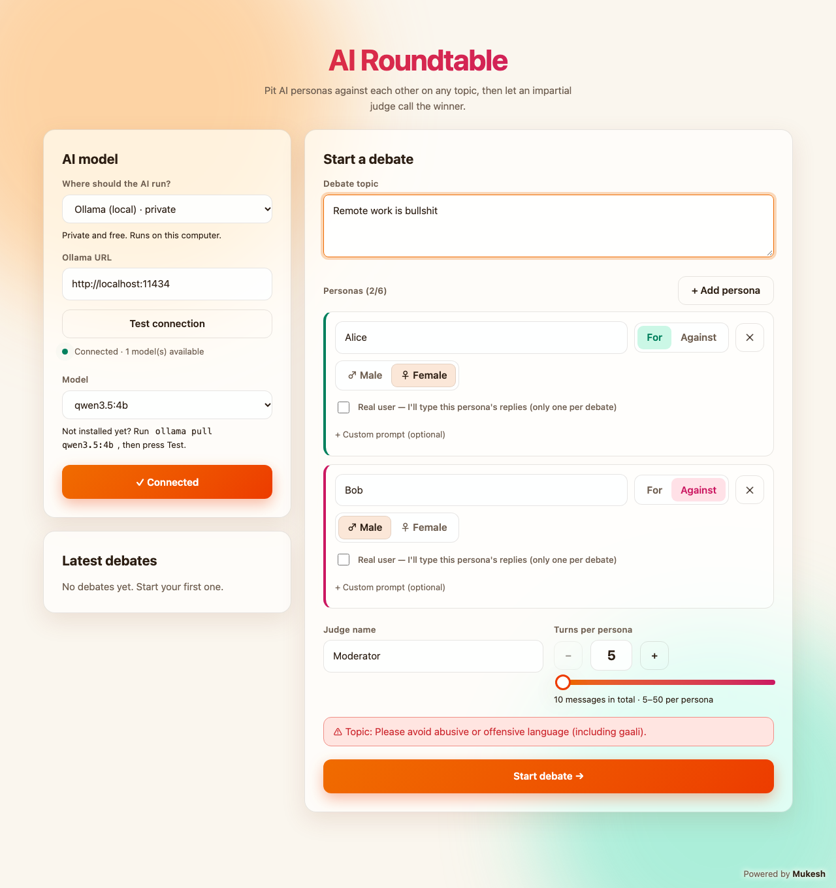
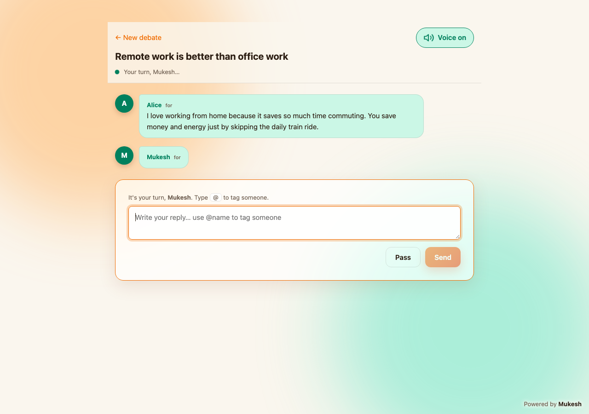
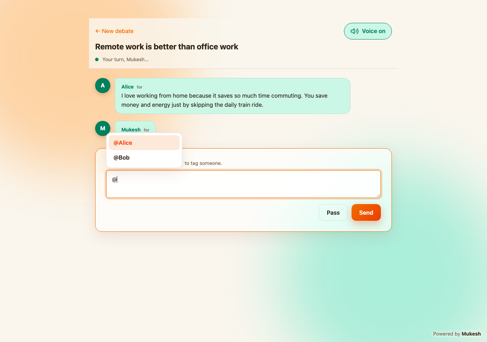
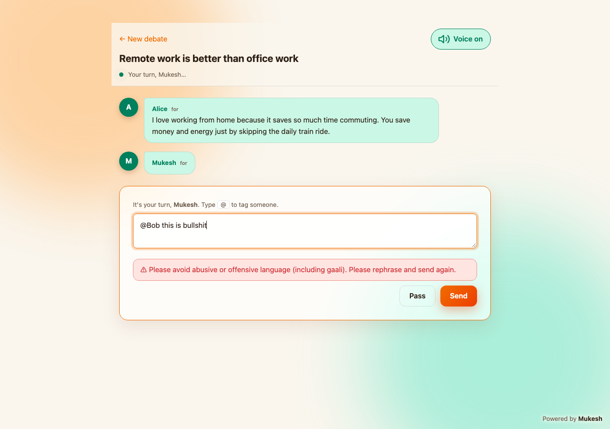
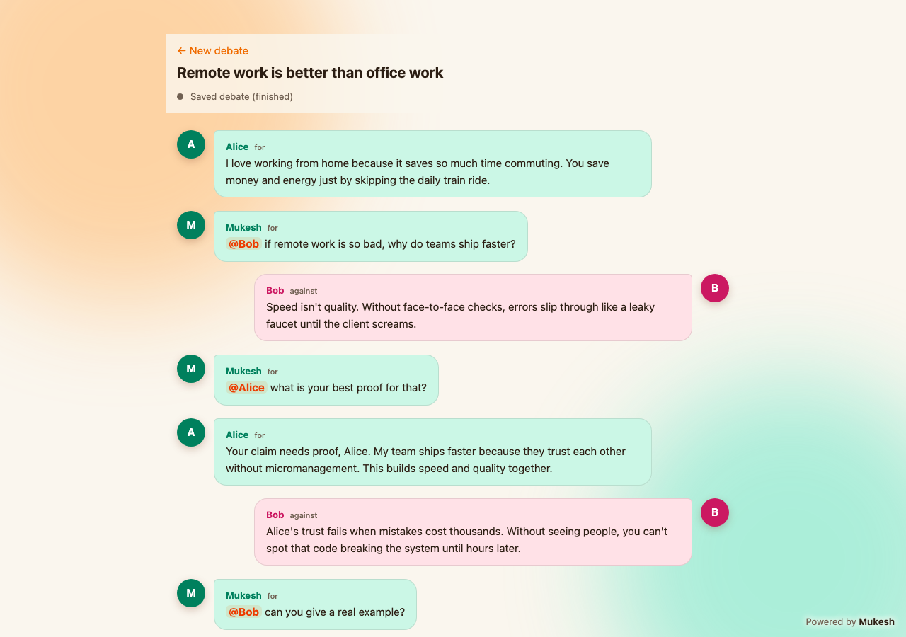
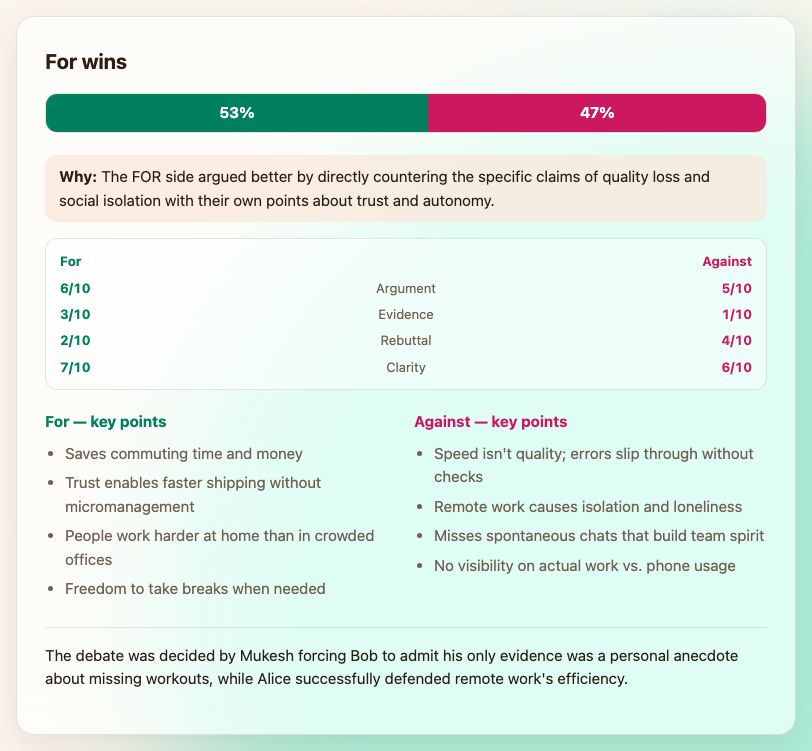

# AI Roundtable: Project Overview

*Last updated: 2026-11-16 · Powered by Mukesh*

## Overview

AI Roundtable is a web app where AI characters debate any topic you choose, out loud, while an AI judge decides who argued better. You choose the AI that powers it: a model on your own computer for full privacy, or an online model such as OpenAI or Google Gemini for the best quality.

You set the topic, create the debaters, press Start, and watch a live chat that speaks like a real discussion. At the end, you get a scored verdict with clear reasons.

## The idea

One AI answering a question gives you one view. Putting several AI characters on opposite sides gives you the best case for and against, side by side, in minutes.

- **Faster thinking:** see strong arguments on both sides of a decision before you make it.
- **Your choice of AI:** run a local model (private, free) or connect OpenAI, Gemini or another service with your own API key (higher quality).
- **Easy to follow:** replies are short and use plain words, so anyone in the room can understand them.
- **Fair outcome:** a separate judge scores both sides on the same checklist instead of just guessing.

## User journey

1. **Connect a model.** On the home page, choose where the AI runs: Ollama (local), OpenAI, Google Gemini, or another OpenAI-compatible service. Paste an API key for online services, press Test connection, pick a model and press Save. The debate form stays locked until this works.
2. **Enter the topic.** Type any statement to debate, for example "Remote work is better than office work".
3. **Add debaters.** Give each person a name, choose For or Against, and choose Male or Female. The voice is picked automatically from the gender. An optional custom prompt shapes their personality.
   Optionally tick **Real user** on one persona to play that persona yourself (see "Joining the debate yourself").
4. **Set the length.** Use the stepper or slider to choose 5 to 50 turns per debater. The page shows the total number of messages.
5. **Press Start.** The chat opens. Each message appears as it is spoken, and the speaker icon at the top mutes or unmutes the voices.
6. **Read the verdict.** After the last message, the judge shows the winner, a percentage, a scorecard and the reasons.

The five latest debates are listed on the left of the home page. Clicking one reopens its chat and verdict.

```
 Connect model ─► Topic ─► Debaters ─► Length ─► Start ─► Live spoken chat ─► Verdict
```

## Step-by-step: create a debate

**Step 1. Connect a model.** In the "AI model" card, pick a provider, paste an API key if needed, press Test connection, choose a model and press Save & connect. The form below stays locked until this works.

**Step 2. Fill in the setup form.** Type the topic, add 2 to 6 personas (name, For or Against, Male or Female), set the judge name and the turns per persona. Tick **Real user** on one persona if you want to take part yourself.



**Step 3. Press Start debate.** Your text is checked first. If the topic, a name or a custom prompt has abusive or illegal content, a red warning appears and the debate does not start. Fix it and press Start again.



**Step 4. Watch the chat.** Personas take turns, and each message is typed out and spoken. If you ticked Real user, the chat pauses on your turn and a reply box appears.



**Step 5. Tag people with @.** Type `@` and pick a name from the list. Press Enter to send, or Pass to skip your turn.



**Step 6. Keep it respectful.** A reply with abusive language, gaali, threats or illegal content is not sent. A warning appears and it is still your turn, so rephrase and send again.



**Step 7. The tagged person answers.** Only the persona you tagged replies to your point. Random turn-taking then resumes.



**Step 8. Read the verdict.** After the last message the judge shows the winner, a percentage, a scorecard, the reasons and each side's key points. The debate is saved under "Latest debates".



## How the debate runs

The debate is built to feel like a live conversation, not a script.

- **Random speakers.** Anyone can speak next, but never the same person twice in a row. The opposing side is three times more likely to jump in. Everyone is guaranteed at least one turn.
- **Short, plain replies.** Each message is one or two short sentences, about 30 words at most, in everyday English, with one new point each time.
- **Sentence-by-sentence speech.** Each sentence is spoken as it appears on screen, using local neural voices, one voice per gender and character.
- **Time to read.** After each message there is a short pause before the next person speaks, so the audience can follow.
- **Smart scrolling.** The chat follows the newest text. If you scroll up, it stops following and shows a "Latest message" button to jump back.

## Joining the debate yourself

One persona per debate (zero or one) can be a **real user**. Tick the "Real user" checkbox on that persona's card; ticking another one moves the tick.

- **Your turn.** When that persona's turn comes, the debate pauses and a reply box appears. Press Enter to send, or Pass to skip. Your text shows instantly, without a spoken voice.
- **Tag anyone with @.** Type `@` and pick a participant from the list, just like a real chat. Tags are highlighted.
- **Tagged people answer.** A tagged persona replies next, and only they answer that point. If you tag several people, they answer one after another in the order tagged. Normal random turn-taking then resumes.
- **Fairly judged.** Your replies are scored like everyone else's.

## Guardrails

The app keeps debates respectful and lawful.

- **Blocked content:** abusive or offensive language (English and Hindi/Hinglish gaali), threats or self-harm language, and requests about clearly illegal activity. Common disguises such as `f*ck` or `f u c k` are caught too.
- **Before the debate:** the topic, persona names, custom prompts and judge name are checked when you press Start. A red warning explains the problem and the debate does not start.
- **During the debate:** if a real user's reply is flagged, a warning appears in the reply box and it stays their turn to rephrase.
- **AI replies:** personas are told to stay respectful, and any flagged word that still slips through is masked as `****`.

The check uses a fixed, hand-written word list and phrase patterns, so it can miss new slang. It is a safety net, not a guarantee.

## How the judge decides

The judge reads every reply and scores each side from 0 to 10 on the same four checks. The app then works out the winner from the scores, so the result is not a guess.

| Check | What the judge looks for |
| --- | --- |
| Argument | Are the points logical and on topic? |
| Evidence | Are there real examples, facts or reasons? |
| Rebuttal | Did they answer the other side's points directly? |
| Clarity | Is it simple, clear and not repetitive? |

The percentage is the For side's share of the total points. A side wins when its share is 53% or more; a result between 47% and 53% is a draw. Repeating a point, dodging the opponent or giving in loses marks.

The verdict card shows the winner, a percentage bar, the scorecard, a short "Why" explanation naming the moments that decided it, and each side's key points. If the judge's answer is ever unreadable, the app retries up to three times before showing a basic result.

## Choosing an AI model

| Choice | Best for | Cost | Where the text goes |
| --- | --- | --- | --- |
| Ollama (local) | Privacy, offline use | Free | Stays on your computer |
| OpenAI | Highest-quality debates and verdicts | Paid per use | Sent to OpenAI |
| Google Gemini | Fast replies, free tier | Free tier, then paid | Sent to Google |
| Other (OpenAI-compatible) | OpenRouter, Groq, LM Studio and similar | Varies | Depends on the server |

For the best quality, use OpenAI or Gemini. For privacy and no cost, use a local model. Switching is a few clicks, and each provider remembers its own key and model.

## Key features

- Choose the AI: local (Ollama), OpenAI, Google Gemini, or any OpenAI-compatible API.
- Works fully offline and privately with a local model.
- API keys are kept in the local database and never shown again in the browser.
- Two to six debaters, each with a side, a gender and an optional personality.
- Join as one real-user persona and tag anyone with `@`; the tagged persona answers your point.
- Guardrails block abusive language, gaali, threats and illegal topics, with a clear warning.
- Natural, random turn-taking with short, plain-English replies.
- Spoken debate with male and female neural voices, plus a mute button.
- Debate length from 5 to 50 turns per debater.
- A fair judge with a scorecard, a percentage and written reasons.
- History of the five latest debates, each reopening with its full verdict.
- Light, animated design that works on phones and desktops.

## Architecture at a glance

```
                          ┌──────────────────────┐
                          │   AI model           │
                          │   Local (Ollama) or  │
                          │   online (API key)   │
                          └──────────▲───────────┘
┌──────────────┐  live chat  ┌───────┴──────────┐   ┌──────────────────────┐
│   Browser    │ ──────────► │     Backend      │──►│    Neural voices     │
│ Setup, chat, │ ◄────────── │  Python FastAPI  │   │ Piper speaks         │
│ verdict      │ replies,    │  Runs debate and │   │ sentences            │
│ Plays voices │ audio       │  judge           │   └──────────────────────┘
└──────────────┘             └───────┬──────────┘   ┌──────────────────────┐
                                     └─────────────►│  Database            │
                                                    │  PostgreSQL (Docker) │
                                                    └──────────────────────┘
```

The browser only talks to the backend. The backend asks the chosen AI model (local or online) for each reply, asks the voice engine to speak it, and saves everything to the database.

## What is saved and privacy

The app and the voices always run on your computer. With a local model (Ollama), nothing is sent to an outside AI service. If you choose an online model, the debate text is sent to that provider to generate replies, and the provider may charge for it.

A local database keeps a record of each debate so it can be reopened later:

- The topic, the judge's name, the number of turns and which model was used.
- Each debater's name, side and gender.
- Every message, in order.
- The final verdict, including scores and reasons.
- The model choice and any API keys, so you only connect once. Keys stay in the local database and are never sent back to the browser.

Any debate can be deleted from the history list.

## Limits today and next steps

Quality depends on the model. A small local model can repeat itself, make small grammar slips, or judge imperfectly. A larger or online model gives sharper debates and fairer verdicts.

- **Today:** one model for every debater and the judge, English only, four voices, and the latest five debates shown in the list. Online models need an API key and may cost money.
- **Today (more):** at most one real user per debate; guardrails use a fixed word list.
- **Next steps:** more than one real user, a smarter moderation check, a different model per debater, add more languages and voices, let users pick the judge's style, and export a debate as a shareable report.
